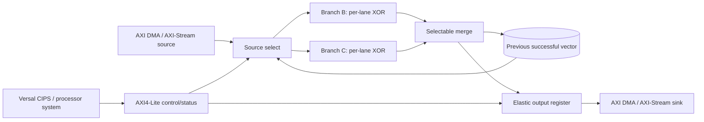

# RAQM Industrial — Versal AI Edge Gen 2 FPGA Datapath

**Repository release:** 4.1.0  
**RTL architecture baseline:** Rev 4.0  
**Project author:** Oğuz Kağan Sayın  
**Project status:** Experimental FPGA datapath prototype / platform-integration candidate  
**License:** RAQM Research-Only, Non-Commercial, No-Production License 1.0

> **Commercial restriction:** Commercial use, commercial manufacturing, commercial production, commercial deployment, sale, licensing, and integration into commercial products or services are prohibited. See [`LICENSE`](LICENSE). This repository is source-available for non-commercial research and evaluation; it is **not** an OSI-approved open-source project.

> **Engineering status:** This is a synchronous FPGA vector datapath prototype, not a general-purpose CPU or ISA, not a QDI/clockless processor, and not a production-qualified or safety-qualified product. No validated G77M carrier-board design, bitstream, timing-closure report, or physical-hardware qualification is included.

## 1. What this project implements

RAQM Rev 4 models a 128-lane vector datapath. Each lane carries one two-bit symbol, so a complete beat is 256 bits wide. All four two-bit values—`00`, `01`, `10`, and `11`—are ordinary payload data. Beat validity is carried by AXI4-Stream `TVALID`/`TREADY`; no payload value is reserved as an idle marker.

For each accepted vector:

1. The source is either the incoming vector or the previous successful output vector, when feedback is enabled and valid history exists.
2. Branch B applies a two-bit XOR mask independently to every lane.
3. Branch C applies a second two-bit XOR mask independently to every lane.
4. B and C are evaluated in parallel in the same synchronous PL clock domain.
5. A merge selector chooses one branch result for the output register.
6. A successful output can become the next feedback vector.

This is a **parallel-compute / selectable-merge** prototype. It does not combine both branch results into one vector and it does not implement an asynchronous rendezvous between independent branch pipelines.

## 2. Architecture



The scalar four-phase `REQ/ACK` reference core is retained separately for study and regression. It is not instantiated in the 256-bit vector product top. AXI valid/ready is synchronous backpressure and does not make the vector datapath clockless.

## 3. Interfaces

### AXI4-Stream input

| Signal | Width | Contract |
|---|---:|---|
| `TDATA` | 256 | 128 two-bit lanes |
| `TKEEP` | 32 | Must be all ones; partial-byte transfers are rejected with status `0x04` |
| `TUSER` | 8 | Per-beat branch, merge, feedback, and XOR-mask controls unless register override is enabled |
| `TLAST` | 1 | Passed through to the output |
| `TVALID/TREADY` | 1 each | Transfer occurs on a rising clock edge when both are high |

`TUSER` control layout:

| Bits | Meaning |
|---|---|
| `[1:0]` | Branch mode: `01` B only, `10` C only, `11` fork/evaluate B and C; `00` invalid |
| `[2]` | Merge select: `0` B, `1` C |
| `[3]` | Feedback enable |
| `[5:4]` | Branch B two-bit XOR mask |
| `[7:6]` | Branch C two-bit XOR mask |

For B-only operation, merge select must be `0`; for C-only operation, merge select must be `1`. In fork mode both branches are evaluated and one is selected for output.

### AXI4-Stream output

| Signal | Width | Contract |
|---|---:|---|
| `TDATA` | 256 | Selected processed vector |
| `TKEEP` | 32 | All ones for each emitted full-width result |
| `TUSER` | 8 | Status byte: `00` success, `01` invalid branch mode, `02` invalid merge selection, `03` feedback requested before valid history, `04` invalid input `TKEEP` |
| `TLAST` | 1 | Exact input `TLAST` value for the accepted beat |

Output payload and sidebands remain stable while `M_TVALID=1` and `M_TREADY=0`.

### AXI4-Lite control/status

The control slave has a 32-bit address and 32-bit data path. AW and W are accepted independently. Invalid, unsupported, unaligned, read-only-write, and write-only-read accesses return `SLVERR`. See [`docs/AXIL_REGISTER_MAP.md`](docs/AXIL_REGISTER_MAP.md).

## 4. Repository layout

- `rtl/` — synthesizable vector datapath, AXI-Lite control, reset synchronizer, and separate scalar reference modules.
- `sim/` — SystemVerilog testbenches and Icarus Verilog runner.
- `tests/` — Python reference model and deterministic randomized tests.
- `sw/` — minimal C MMIO header and bring-up example.
- `vivado/` — RTL synthesis project Tcl and platform-integration notes.
- `constraints/` — clock/reset template only; no unverified physical package pins.
- `docs/` — architecture, protocol, register map, requirements, device-selection notes, validation plan, and release gates.
- `kicad/` — optional isolated maintenance-interface sheet source and an unfilled vendor-controlled B2B pin-map template.
- `.github/` — CI, issue templates, and pull-request template.

## 5. Quick start

Requirements: Python 3.10+, `make`, and GCC. On Debian/Kali:

```bash
sudo apt update
sudo apt install -y python3 python3-venv make gcc
python3 -m venv .venv
. .venv/bin/activate
python -m pip install --upgrade pip
make check
```

Run SystemVerilog regression with Icarus Verilog:

```bash
sudo apt install -y iverilog
make rtl-test
```

Optional Verilator lint:

```bash
sudo apt install -y verilator
make rtl-lint
```

See [`BUILD.md`](BUILD.md) for the full reproducible workflow.

## 6. FPGA platform status

The product RTL is intended to be integrated as an IP block inside a Versal CIPS/NoC platform design. The current repository includes an RTL-only Vivado project Tcl; it does not create a completed CIPS/NoC block design, connect AXI DMA, generate an XSA, implement/place-route, or produce a PDI/bitstream.

The preliminary iWave G77M REL0.1 documentation identifies XC2VE3858 / SSVA2112 compatibility, while the ordering details and exact speed/temperature grade must be confirmed against a controlled current iWave document. Do not invent the full Vivado part string or freeze a carrier-board pin map from the placeholder template. See [`docs/DEVICE_SELECTION.md`](docs/DEVICE_SELECTION.md) and [`docs/G77M_CARRIER_SCOPE.md`](docs/G77M_CARRIER_SCOPE.md).

The nominal 100 MHz clock in the XDC is an initial design target only. `256 bits × 100 MHz = 25.6 Gbit/s` is a theoretical raw datapath rate under one accepted beat per cycle; it is not a measured throughput claim.

## 7. Verification status

The current local source checks are recorded in [`docs/VERIFICATION_STATUS.md`](docs/VERIFICATION_STATUS.md). Python reference tests and static checks do not prove RTL correctness, synthesis closure, CDC safety, board signal integrity, thermal performance, EMC compliance, or physical reliability. Do not publish performance or qualification claims without the corresponding archived tool reports and hardware test evidence.

## 8. License and permitted publication

This repository is published under the custom **RAQM Research-Only, Non-Commercial, No-Production License 1.0** in [`LICENSE`](LICENSE).

Permitted uses are limited to non-commercial research, education, peer review, and technical evaluation, including non-commercial evaluation prototypes. **Commercial use and commercial production are prohibited**, including manufacturing, contract manufacturing, pilot production, commercial product integration, paid engineering, sale, rental, licensing, and commercial deployment.

This is not an OSI-approved open-source license. A public GitHub repository makes the source visible; it does not grant commercial production rights. GitHub's public-repository terms separately address viewing and forking, while the project's `LICENSE` governs other reuse permissions. See [GitHub's licensing documentation](https://docs.github.com/en/repositories/managing-your-repositorys-settings-and-features/customizing-your-repository/licensing-a-repository).

Third-party tools and vendor materials remain under their own terms. See [`THIRD_PARTY_NOTICES.md`](THIRD_PARTY_NOTICES.md).

## 9. Suggested repository metadata

- Repository name: `raqm-industrial-g77m`
- Short description: `Research-only 256-bit RAQM vector datapath prototype for AMD Versal AI Edge Gen 2.`
- Suggested topics: `fpga`, `versal`, `systemverilog`, `axi4-stream`, `axi4-lite`, `hardware-research`, `vector-datapath`, `non-commercial`

Read [`GITHUB_PUBLISHING.md`](GITHUB_PUBLISHING.md) before creating a public repository.
